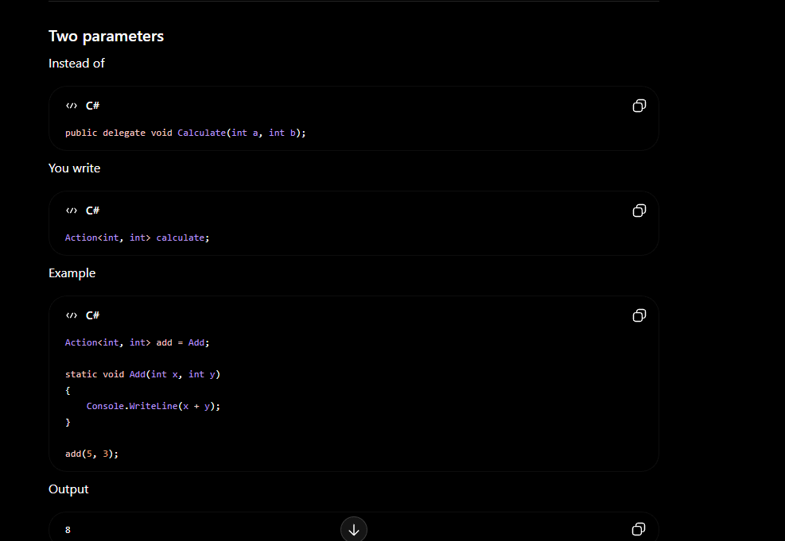
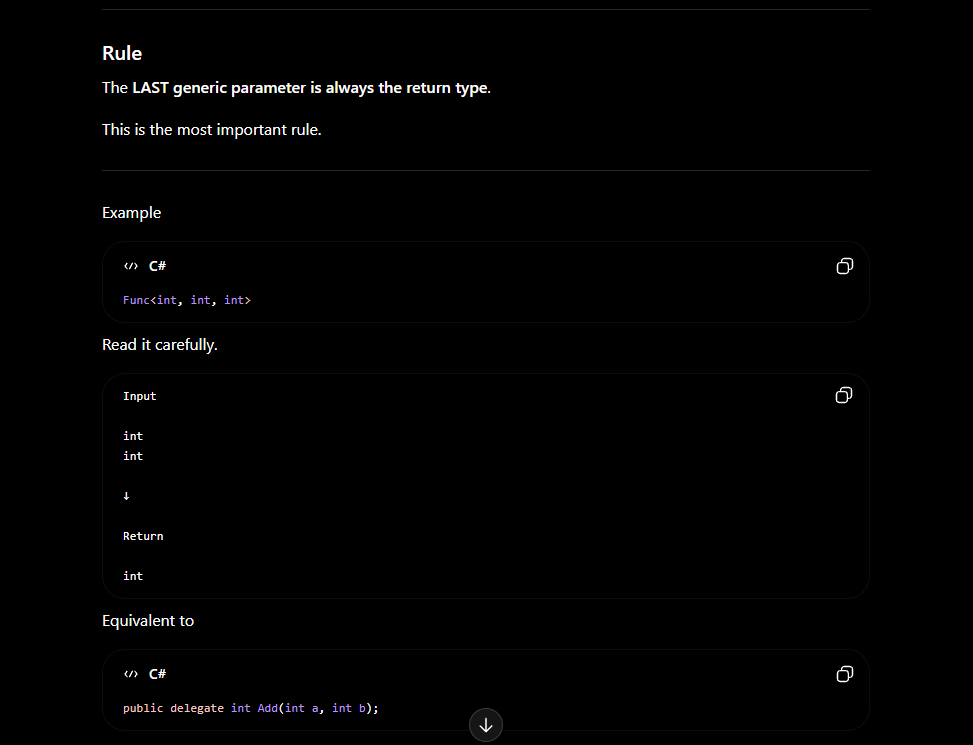
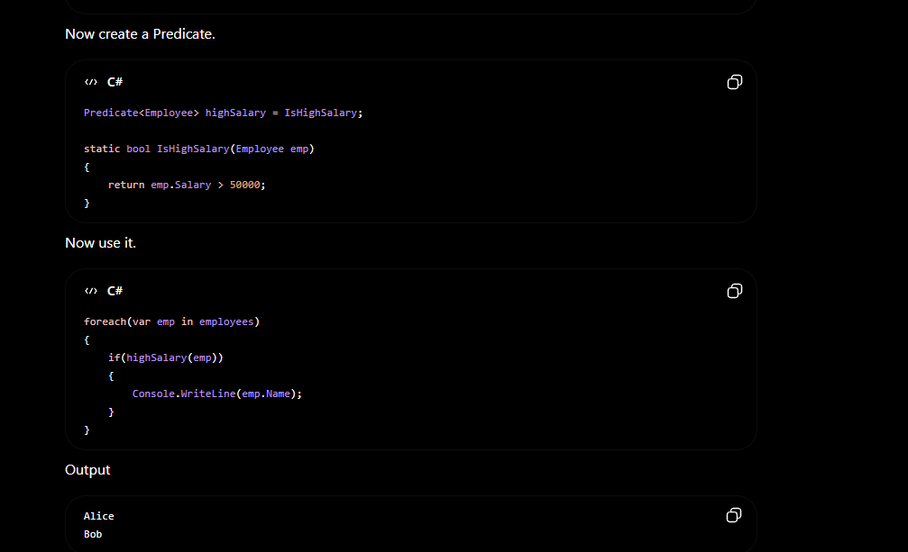

ACTIONS -> doesn't have return type
1.
Rule to remember
Action<T1,T2,T3,...>

Everything inside < > is an input parameter.

There is no return value.

2.

3.

Example

Action<string> print = Print;

static void Print(string message)
{
    Console.WriteLine(message);
}

print("Hello");

Output

Hello

4.FUNC -->>>

Example

Func<int, int, int> add = Add;

static int Add(int a, int b)
{
    return a + b;
}

Console.WriteLine(add(10,20));

Output

30

-----------------------------------------------
Easy Trick

Action

Everything is input.

Func

Last is output.

Everything before it is input.

-------------------------------------------------
