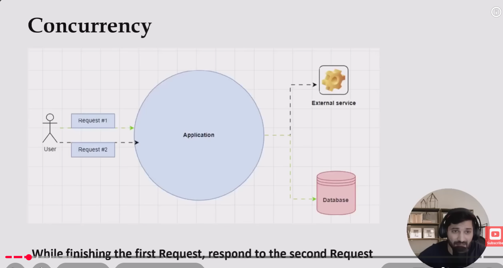
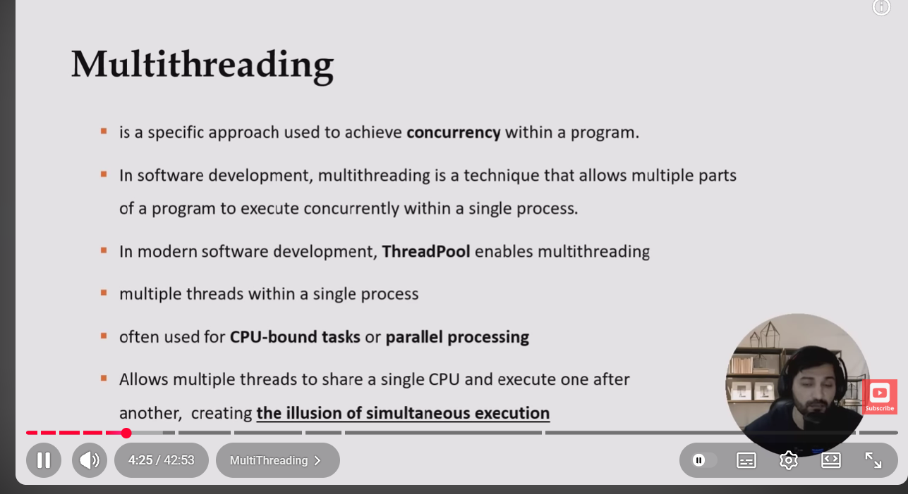
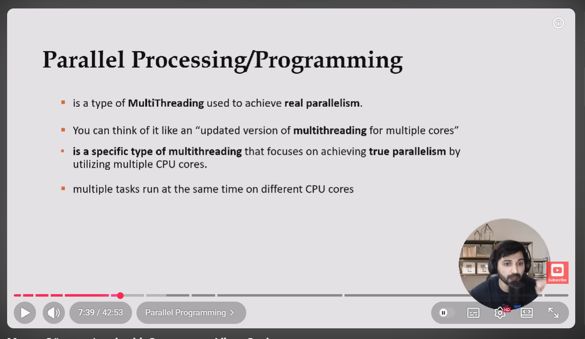
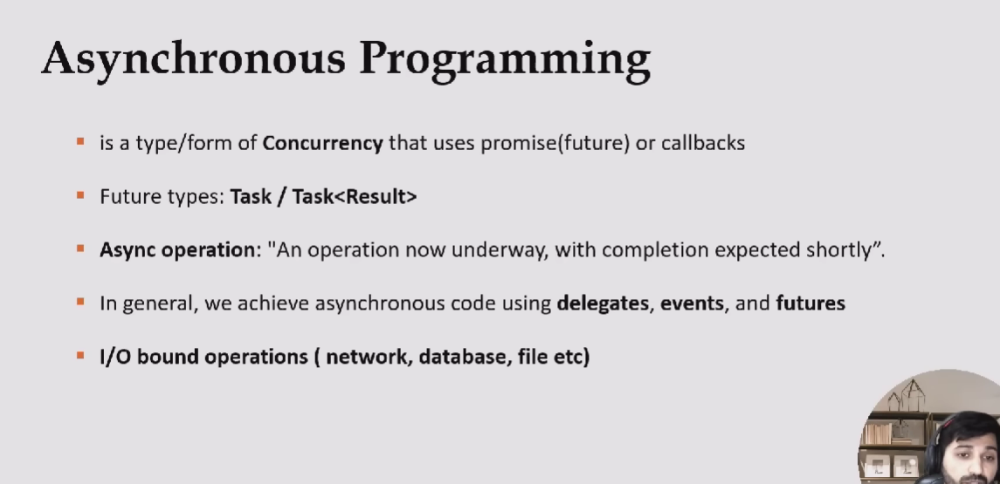
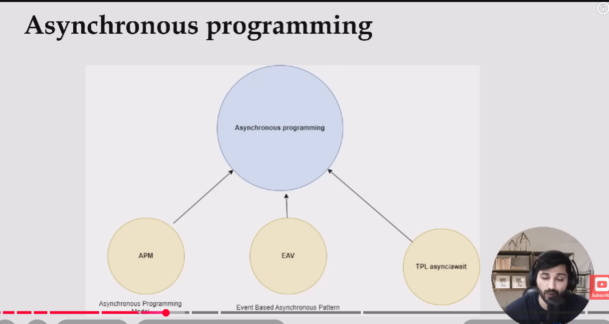
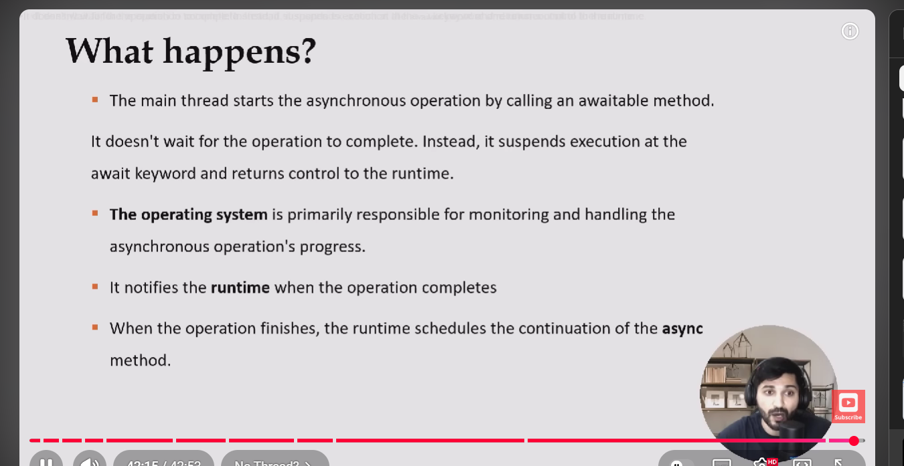

The core design pattern behind async and await is the State Machine pattern

Thread :
A Thread is an operating system execution unit that actually runs code.
Creating a thread is relatively expensive because it requires OS resources and scheduling. 
A Task is a higher-level abstraction representing a unit of asynchronous work.
A Task doesn't necessarily create a new thread; it is typically scheduled on the .NET Thread Pool 
and can even complete without holding a thread during asynchronous waits (for example, await Task.Delay() 
or asynchronous I/O). In modern .NET applications, we generally prefer 
Task over manually creating Thread objects because it provides better scalability,
easier composition with async/await, and more efficient resource usage.