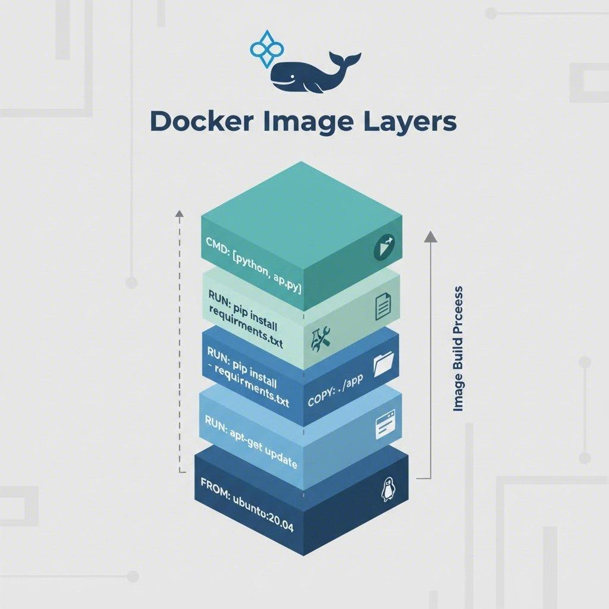
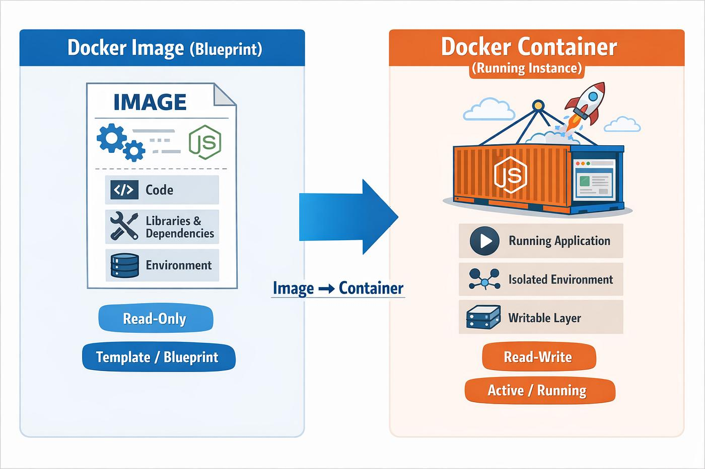
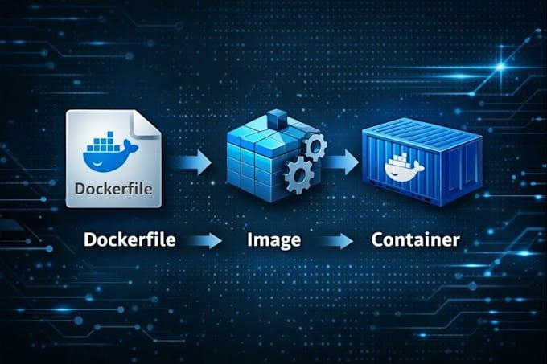
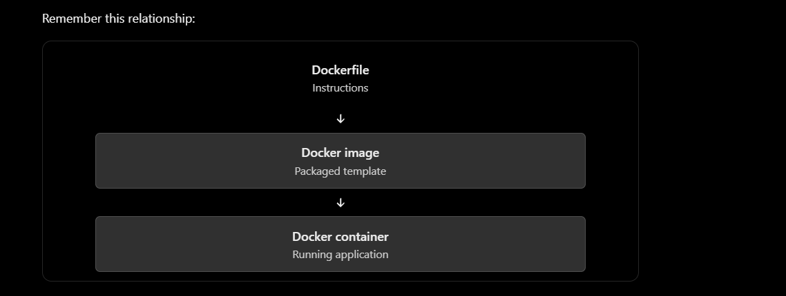
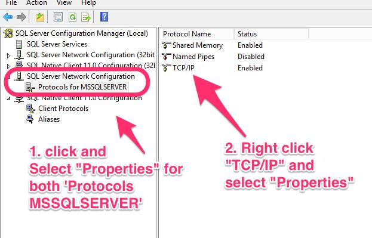
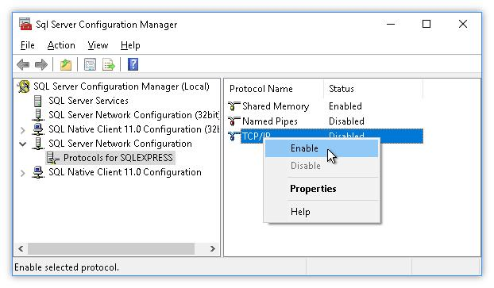

Docker Image-

Docker Container - 

DockerFile - 

The three concepts you must understand first

1. Docker image
Think of it as a packaged template. For our API, it will contain the published application and the .NET runtime or SDK components needed by the chosen image design.

2. Docker container
A running instance of an image. You can create multiple containers from the same image.

3. Dockerfile
A text file containing instructions for building an image: which base image to use, where to place files, which commands to run, and how to start the application.

Lesson 4 — Run your first interactive container
Step 1: Start an Ubuntu container
Open Windows PowerShell and run:
docker run -it --name ubuntu-practice ubuntu bash

The first run may take a little time while Docker downloads the Ubuntu image.
What does each part mean?
Part	Meaning
docker run	Create and start a container
-it	Enable interactive terminal input/output
--name ubuntu-practice	Give the container a memorable name
ubuntu	The image to use
bash	The program to run inside the container
Notice the difference: you're running Ubuntu inside a Docker container, not opening your existing WSL Ubuntu installation.

Lesson 5: Port Mapping (-p)
1. Understand the problem first
Imagine your ASP.NET Core API is running inside a Docker container on port 8080.
Your Windows browser is outside that container. How can it access the API?
Docker uses port mapping to connect a port on your Windows machine to a port inside the container.
Your Windows machine
Browser: http://localhost:8080

Docker port mapping
Host port 8080 → Container port 80

Docker container
Web server listens on port 80

The syntax is:
docker run -p HOST_PORT:CONTAINER_PORT IMAGE

For example, -p 8080:80 means traffic reaching port 8080 on your Windows machine is forwarded to port 80 inside the container.
2. Run a web server in Docker
We'll use Nginx, a lightweight web server, so you can learn port mapping without writing application code.
First, make sure you're back in PowerShell, not inside Ubuntu.
Run:
docker run -d --name nginx-practice -p 8080:80 nginx

What each part means:
Part	Meaning
docker run	Create and start a container
-d	Run it in the background
--name nginx-practice	Give the container a name
-p 8080:80	Map Windows port 8080 to container port 80
nginx	Use the Nginx image

Step 2: Enable TCP/IP for SQL Server
Your API runs inside a Linux container, while SQL Server runs on Windows. They need a network connection, typically over TCP/IP.

1. Open SQL Server Configuration Manager
Press the Windows key and search for SQL Server Configuration Manager.

2. Find TCP/IP
Navigate to SQL Server Network Configuration → Protocols for your instance.
Right-click TCP/IP and select Enable if it is disabled.

3. Check the TCP port
Right-click TCP/IP → Properties → IP Addresses. Scroll to IPAll and inspect:
- TCP Dynamic Ports
- TCP Port
Don't change these values yet. We first need to see your current configuration.

If you have multiple SQL Server instances, make sure you're checking the instance you use in SSMS.

On Windows, localhost refers to your Windows machine.
Inside a Docker container, localhost refers to that container itself.

Your result tells us:
- Server: LAPTOP-6ST99627
- Instance name: NULL, which indicates the default SQL Server instance.
- Version: 17.0.1135.8 — SQL Server 2025.
- Edition: Standard Developer Edition (64-bit).
The Configuration Manager shortcut I mentioned earlier was for SQL Server 2022, so it may not be the correct one for your installation.
Step 2B: Find the SQL Server 2025 Configuration Manager
Try this in PowerShell:
Get-ChildItem C:\Windows\SysWOW64\SQLServerManager*.msc

If that returns nothing, try:
Get-ChildItem "C:\Program Files (x86)\Microsoft SQL Server" `
  -Filter "SQLServerManager*.msc" -Recurse -ErrorAction SilentlyContinue

Microsoft lists this exact path for SQL Server 2025: C:\Windows\SysWOW64\SQLServerManager17.msc. 

Microsoft Learn

You can open it directly with:
Start-Process "C:\Windows\SysWOW64\SQLServerManager17.msc"

If it opens, navigate to:
SQL Server Network Configuration → Protocols for MSSQLSERVER → TCP/IP
Enable TCP/IP if needed, then open its Properties → IP Addresses → IPAll. Send me the TCP Dynamic Ports and TCP Port values.
If the command says the file doesn't exist, paste that error. We'll use another route to inspect the configuration.

You're running Command Prompt (CMD), not PowerShell. That's why Get-ChildItem and Start-Process aren't recognized. No worries — you don't need to close this window.
Step 1: Open PowerShell
In your current CMD window, type:
powershell

Press Enter. Your prompt should change from:
C:\Users\csban>
to something beginning with:
PS C:\Users\csban>
Step 2: Find Configuration Manager
Now run this command in PowerShell:
Get-ChildItem C:\Windows\SysWOW64\SQLServerManager*.msc

If it returns nothing, try opening the SQL Server 2025 Configuration Manager directly:
Start-Process "C:\Windows\SysWOW64\SQLServerManager17.msc"

Step 3: Tell me what happens
- If Configuration Manager opens, we'll enable TCP/IP.
- If the file isn't found, send me the output. We'll use an alternative method.
Important: Run these commands only after you see PS at the beginning of your prompt.

Command to open  Start-Process "C:\Windows\SysWOW64\SQLServerManager17.msc"

Sql serve configuration manager 

Perfect! You're in the correct TCP/IP Properties → IP Addresses window for SQL Server 2025.
From your screenshot, I can see:
- IPAll → TCP Port: 1433
- IPAll → TCP Dynamic Ports: blank
- Individual IP entries show Enabled: No in the visible rows. We still need to verify the protocol's overall status.
Let's proceed carefully.
Step 2: Enable TCP/IP and restart SQL Server
1. Click Cancel for now if you haven't changed anything in this window.
2. Back in Protocols for MSSQLSERVER, check the TCP/IP row.
3. If its Status is Disabled, right-click it and select Enable.
4. If you enabled it, you'll need to restart the SQL Server service:
   - Open SQL Server Configuration Manager.
   - Select SQL Server Services.
   - Right-click SQL Server (MSSQLSERVER) and select Restart.
Keep the IPAll port set to 1433 and the dynamic port field blank for now.
Step 3: Confirm the settings
Once SQL Server has restarted, open PowerShell and run:
Test-NetConnection localhost -Port 1433

Look for:
TcpTestSucceeded : True

If it says True, the port is reachable from Windows. This is a useful first check, although we'll still need to verify connectivity from Docker.
Tell me two things:
1. Was TCP/IP disabled, and did you enable it?
2. Does Test-NetConnection return TcpTestSucceeded : True?

Excellent! ✅ TcpTestSucceeded : True means SQL Server is accepting TCP connections on port 1433 from Windows itself.
Now let's create a separate SQL login for your Dockerized API. Your existing Windows Authentication login in SSMS will continue to work.
Step 3: Create a SQL login for AuthenticationServer
In SSMS, connect using Windows Authentication, click New Query, and run the following SQL.
First, create a login with a strong password of your choice. Replace YOUR_STRONG_PASSWORD_HERE with your own password before executing; don't share it in chat.
USE master;
GO

CREATE LOGIN AuthApiLogin
WITH PASSWORD = 'YOUR_STRONG_PASSWORD_HERE',
     CHECK_POLICY = ON;
GO

This creates a SQL Server login named AuthApiLogin. It does not yet grant access to your application database.
Important: Use a strong, unique password and keep it private. If SQL Server reports that the login already exists, don't rerun the creation statement; tell me the error.
Step 4: Grant access to AuthenticationDb
Before running the next query, verify that your database exists:
SELECT name
FROM sys.databases
WHERE name = 'AuthenticationDb';

- If it returns AuthenticationDb, continue with the next query.
- If it returns no rows, stop and tell me. We'll check how your application database is currently created.
If the database exists, run:
USE AuthenticationDb;
GO

CREATE USER AuthApiLogin FOR LOGIN AuthApiLogin;
GO

ALTER ROLE db_datareader ADD MEMBER AuthApiLogin;
ALTER ROLE db_datawriter ADD MEMBER AuthApiLogin;
GO

This gives the login permission to read and modify data in AuthenticationDb. It does not grant database-owner privileges. If your API needs to run EF Core migrations, we'll handle migration permissions separately rather than granting excessive access.
Step 5: Confirm before changing the API configuration
Once you've completed these steps, tell me whether both queries succeeded. Then we'll configure the API's connection string to use:
- Server: host.docker.internal,1433
- Database: AuthenticationDb
- User: AuthApiLogin
- Password: supplied through a Docker environment variable
We won't put the password directly in appsettings.json or the Dockerfile.

docker rm -f authentication-server

docker run -d `
  --name authentication-server `
  -p 8081:8080 `
  -e ASPNETCORE_HTTP_PORTS=8080 `
  -e ASPNETCORE_ENVIRONMENT=Development `
  -e "ConnectionStrings__DefaultConnection=Server=host.docker.internal,1433;Database=AuthenticationDb;User ID=AuthApiLogin;Password=$env:AUTH_DB_PASSWORD;Encrypt=True;TrustServerCertificate=True;" `
  authentication-server:v2

  ------------------------------------------------------------------------------------------------------------------------------------------------------------------------

  yes its open but te ll me from scratch what we have done
Docker from scratch — what we have done with your AuthenticationServer
Let's rewind and understand everything from the beginning, using your actual .NET AuthenticationServer project.

Our goal was to take an API that runs on your Windows machine and run it inside a Docker container, while keeping your existing SQL Server database on Windows.

1. First, understand the big picture
Your Windows machine

PowerShell · Docker Desktop · SQL Server

Docker starts your application

AuthenticationServer container

ASP.NET Core API · Port 8080

Container port 8080

Port mapping: 8081 → 8080

Your browser

http://localhost:8081/swagger

SQL Server on Windows

AuthenticationDb · Port 1433

The API connects separately to SQL Server through host.docker.internal:1433.

The important point: Docker runs your API in a container, but your database is still running directly on Windows. We have not containerized SQL Server yet.

2. What is Docker, and why did we install it?
Docker lets you package an application with the runtime and dependencies it needs, then run it in an isolated environment called a container.

Think of these terms as follows:

Term

Meaning in your project

Docker Desktop

The application that lets you run Docker on Windows.

Docker image

The packaged template containing your published API and .NET runtime environment.

Docker container

A running instance created from an image.

Dockerfile

Instructions for building your image.

Port mapping

A connection between a port on Windows and a port inside the container.

Docker CLI

The docker commands you typed in PowerShell.

We first checked that Docker was working by running:

docker run hello-world

Docker downloaded a small test image if needed, created a container, ran it, printed a success message, and exited.

Then we practised with Ubuntu and Nginx:

Ubuntu: created a container and wrote a file to practise container lifecycle commands.

Nginx: started a web server and mapped Windows port 8080 to container port 80.

These were practice exercises before running your actual .NET API.

3. We created a Dockerfile
Inside your project folder:

AuthenticationServer/
├── AuthenticationServer.csproj
├── Program.cs
├── appsettings.json
├── Controllers/
├── Models/
├── Services/
└── Dockerfile
We created a file named Dockerfile. It tells Docker how to build your application image.

The version we used is essentially:

FROM mcr.microsoft.com/dotnet/sdk:9.0

WORKDIR /app

COPY . .

RUN dotnet restore

RUN dotnet publish -c Release -o /app/publish

WORKDIR /app/publish

EXPOSE 8080

ENTRYPOINT ["dotnet", "AuthenticationServer.dll"]

Let's understand every instruction.

FROM — choose the base image
FROM mcr.microsoft.com/dotnet/sdk:9.0

We told Docker to start with Microsoft's .NET 9 SDK image.

It provides the .NET SDK and tools needed to restore, build, and publish your application.

Think of this as choosing the starting environment for your application.

WORKDIR — choose the working directory
WORKDIR /app

Docker sets /app as the working directory inside the image.

This is not the same directory as your Windows project folder. It exists inside the image/container.

COPY — copy the project files
COPY . .

This copies files from the Docker build context (your project directory) into the current working directory inside the image.

In our case, your project files are copied into /app.

RUN dotnet restore — restore NuGet dependencies
RUN dotnet restore

This restores the packages your application needs, such as Entity Framework Core and ASP.NET Core authentication packages.

It is similar to running dotnet restore locally.

RUN dotnet publish — prepare the application
RUN dotnet publish -c Release -o /app/publish

This publishes your application in Release configuration into /app/publish.

The published output includes AuthenticationServer.dll and the other files needed to run the API.

The second WORKDIR — fix our earlier issue
WORKDIR /app/publish

Initially, we had a problem because the application DLL was in /app/publish, but Docker was trying to start it from /app.

Changing the working directory fixed that mismatch.

EXPOSE — document the container port
EXPOSE 8080

This documents that the application is intended to listen on port 8080 inside the container.

Important: EXPOSE does not publish the port to Windows by itself. We do that with docker run -p.

ENTRYPOINT — start the API
ENTRYPOINT ["dotnet", "AuthenticationServer.dll"]

This tells Docker what process to run when a container starts from the image.

In our case, it starts your .NET API.

4. We built a Docker image
We ran a command equivalent to:

docker build -t authentication-server:v2 .

Let's break it down:

docker build: build an image using the Dockerfile.

-t: give the image a name and tag.

authentication-server: the image name.

v2: the tag, or version label, we assigned.

.: use the current directory as the build context.

The build succeeded, creating the image authentication-server:v2.

The relationship is:

Dockerfile

Build instructions

Docker image

authentication-server:v2

Docker container

authentication-server

An image is the packaged template. A container is a created instance of that image.

You can create multiple containers from the same image, although they need suitable names and port mappings.

5. We started the container
This was the command we used, with your SQL password supplied through a PowerShell environment variable:

docker run -d `
  --name authentication-server `
  -p 8081:8080 `
  -e ASPNETCORE_HTTP_PORTS=8080 `
  -e ASPNETCORE_ENVIRONMENT=Development `
  -e "ConnectionStrings__DefaultConnection=Server=host.docker.internal,1433;Database=AuthenticationDb;User ID=AuthApiLogin;Password=$env:AUTH_DB_PASSWORD;Encrypt=True;TrustServerCertificate=True;" `
  authentication-server:v2

PowerShell uses the backtick (`) to continue a command on the next line.

Here is what each part does.

Command part

What it means

docker run

Create and start a container.

-d

Run in detached mode, in the background.

--name authentication-server

Assign a convenient container name.

-p 8081:8080

Map Windows port 8081 to container port 8080.

ASPNETCORE_HTTP_PORTS=8080

Configure ASP.NET Core to listen on port 8080.

ASPNETCORE_ENVIRONMENT=Development

Run the API in Development mode.

ConnectionStrings__DefaultConnection=...

Override the application's database connection string.

authentication-server:v2

The image from which the container is created.

The long random string Docker printed was the container ID.

Why do we use port 8081:8080?
The syntax is:

-p WINDOWS_PORT:CONTAINER_PORT
Your API listens on port 8080 inside the container. We exposed it on port 8081 on Windows.

So when you open:

http://localhost:8081/swagger

the request travels to port 8081 on Windows, which Docker forwards to port 8080 inside the container.

Why host.docker.internal?
Your SQL Server is running on Windows, outside the container.

From inside the container, localhost refers to the container itself—not your Windows host. Therefore, we use:

host.docker.internal,1433
This lets the API connect to SQL Server on your Windows machine through port 1433.

The connection string selects the AuthenticationDb database and uses the AuthApiLogin SQL login.

Why use an environment variable for the password?
This part:

$env:AUTH_DB_PASSWORD

reads the password from your current PowerShell environment.

It means you don't have to type the password directly into the command. However, environment variables are not a complete secrets-management solution: container environment variables can be inspected by users with sufficient Docker access. For production, use a proper secrets-management approach.

If you haven't already rotated the SQL password you previously shared in chat, change it before using this setup beyond local learning.

6. We fixed the Swagger 404 error
When you first opened Swagger, you received a 404.

We inspected Program.cs and found:

if (app.Environment.IsDevelopment())
{
    app.UseSwagger();
    app.UseSwaggerUI();
}

This means Swagger is enabled only when ASP.NET Core considers the environment to be Development.

Docker was initially running the application in Production mode, so those middleware components were not enabled.

We fixed this for local development by adding:

-e ASPNETCORE_ENVIRONMENT=Development

After restarting the container, your logs showed:

Now listening on: http://[::]:8080
Application started.
Hosting environment: Development
Content root path: /app/publish
And Swagger opened successfully.

Security note: Keep Development mode for local learning. For a real production deployment, configure Swagger and other development-only features according to your security requirements.

7. How we check whether the container is running
These are the Docker commands worth remembering.

Check running containers

docker ps

Shows containers that are currently running.

Show all containers, including stopped ones

docker ps -a

A container can exist even when it has stopped.

Read application logs

docker logs --tail 40 authentication-server

Useful for startup failures, exceptions, and connection problems.

Stop the container

docker stop authentication-server

Start the existing stopped container

docker start authentication-server

Remove the container

docker rm -f authentication-server

This force-removes the container if it exists. It does not remove the image.

List your images

docker images

You should see authentication-server with the v2 tag.

8. What about the warnings in your logs?
You saw warnings about Data Protection keys and HTTPS redirection.

Data Protection keys: They are stored inside the container by default. When the container is removed, those keys may be lost. This can affect features that depend on persistent Data Protection keys. We haven't configured persistent storage for them.

HTTPS redirection: The app tried to determine an HTTPS port but could not. For our current local test, we are accessing the HTTP endpoint. A production deployment should configure HTTPS and its forwarding/proxy settings correctly.

These warnings did not prevent the API from starting.

9. What we have and haven't completed
Completed

Installed and verified Docker Desktop.

Practised with Ubuntu and Nginx containers.

Created a Dockerfile for your .NET 9 API.

Built the authentication-server:v2 image.

Started the API in a container.

Mapped the container port to Windows.

Configured the connection string for your Windows SQL Server.

Enabled Swagger for local development.

Still to do

Test a database-backed Register/Login request end-to-end.

Learn Docker volumes and container networking.

Create a docker-compose.yml to manage the API and its configuration more easily.

Learn how to containerize SQL Server separately, if desired.

Improve the Dockerfile for production, including a smaller runtime image and appropriate secret handling.

One detail to remember: our current Dockerfile uses the .NET SDK image to build and run the application. That is fine for learning, but a production Dockerfile commonly uses a multi-stage build and a smaller ASP.NET Core runtime image for the final stage.

10. Your next step
Before moving to Docker Compose, let's verify the most important thing: can the containerized API actually read and write to SQL Server?

Open Swagger at http://localhost:8081/swagger and try registering a new test user, then logging in with that user.

If both requests succeed, we will know that the API, Docker networking, SQL login, and database are working together—not merely that the API process started.