Cookies are small pieces of data that are stored on the client's device by the server and sent back to the server with each request. Cookies can contain various information about the user's identity, preferences, history, etc. Cookies can make HTTP stateful by allowing the server to recognize and remember the user across multiple requests and responses.

Sessions are temporary storage spaces that are created on the server for each user who accesses a web application. Sessions can contain various information about the user's activity, data, status, etc. Sessions can make HTTP stateful by allowing the server to keep track and manage the user's interaction with a web application across multiple requests and responses.

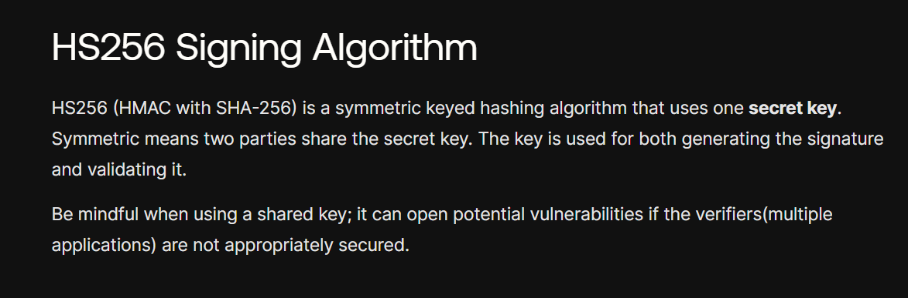
https://auth0.com/blog/rs256-vs-hs256-whats-the-difference/

---------------------------------------------------------------------------------------

AuthenticationServer

EndPoints
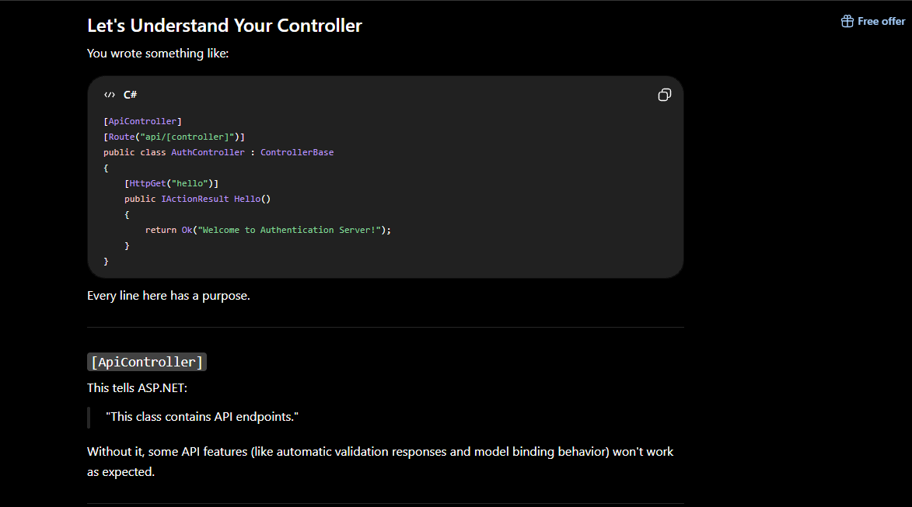

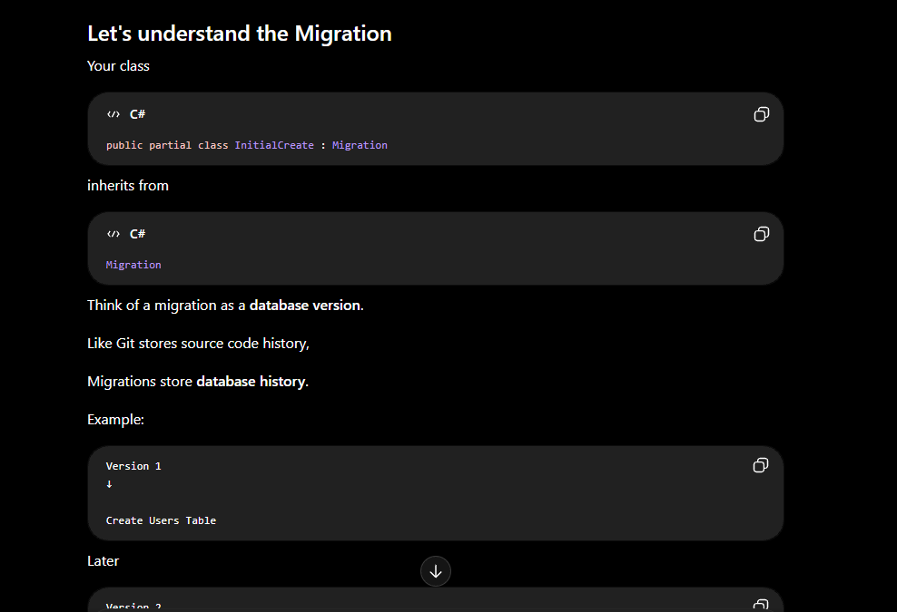 in Migaration file 
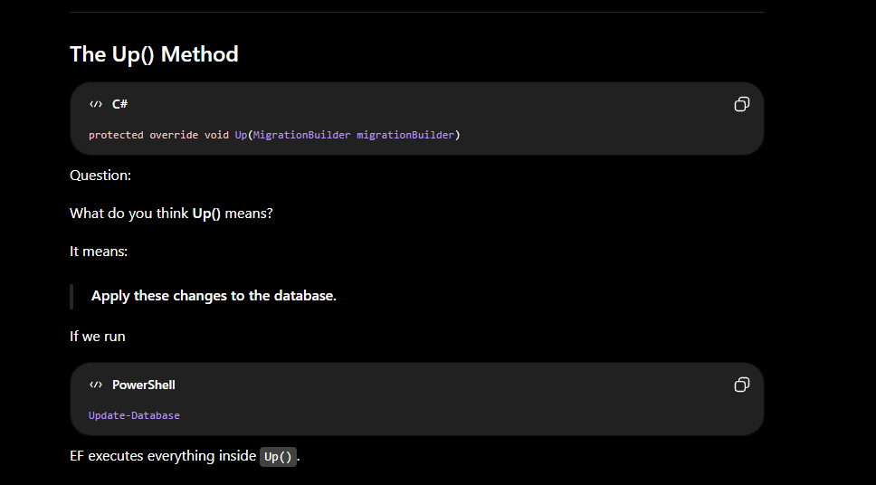

___________
APICONTROLLER 
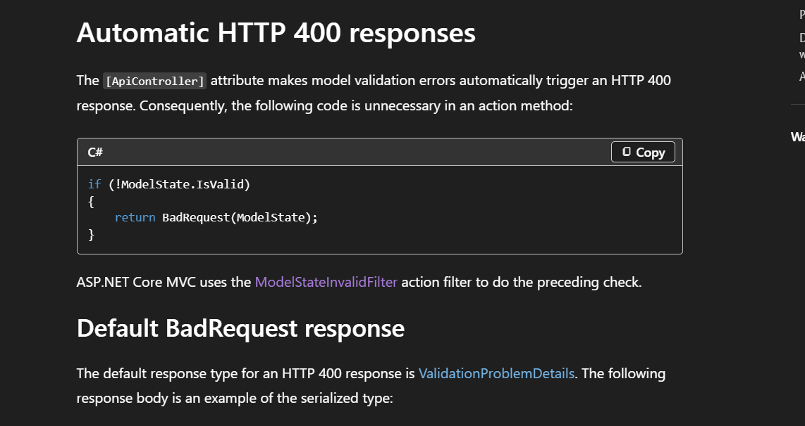

---------------------------------------------------------------------------
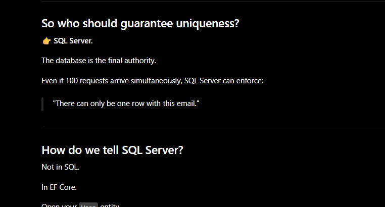
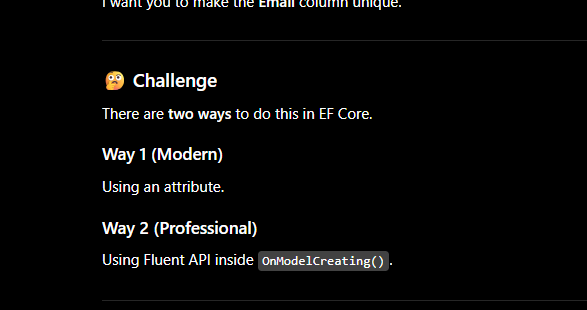
🚀 EF Core Tip: How to Make Any Column Unique in ASP.NET Core

In real-world applications, we often need to make sure certain fields (like Email, Username, or Phone Number) are unique — meaning no duplicates are allowed in the database.

Here’s how you can easily do that in Entity Framework Core 👇

---

💡 Option 1: Using Data Annotation (EF Core 6+)

[Index(nameof(Email), IsUnique = true)]
public class User
{
 public int Id { get; set; }
 public string Email { get; set; } // ✅ Unique column
}

✅ When you run Add-Migration and Update-Database,
EF Core automatically creates a unique index on the Email column.

---

💡 Option 2: Using Fluent API (works in all EF Core versions)

modelBuilder.Entity<User>()
 .HasIndex(u => u.Email)
 .IsUnique();

📌 You can also create composite unique keys:

modelBuilder.Entity<User>()
 .HasIndex(u => new { u.FirstName, u.LastName })
 .IsUnique();

---

🔥 Pro Tip:
When you insert a duplicate value, EF Core will throw a DbUpdateException.
Handle it gracefully to show a user-friendly message in your app.

-------------------------------------------------------------------------------------

As we have also applied it on the DB that email should be unique , suppose there comes a many requests how this race comdition can be handle if not handle we awill get the exception --->>
SaveChangesAsync()

↓

DbUpdateException

-------------------------------------------------------
Notice the last line:

throw;

Not

throw ex;
Why?

This is another important .NET concept.

throw; preserves the original stack trace. ✅
throw ex; resets the stack trace, making debugging harder. ❌

----------------------------------------------------------------------------------------------------------------

Claims Principle 

https://stackoverflow.com/questions/32584074/whats-the-role-of-the-claimsprincipal-why-does-it-have-multiple-identities

---------
Authorzation Types 
Role base , policy base , claim base 

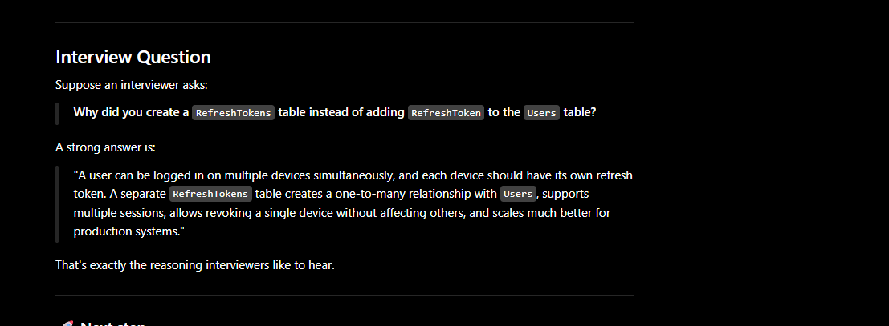

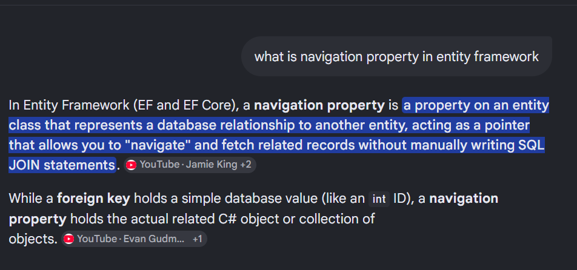

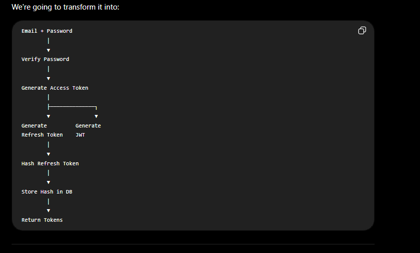

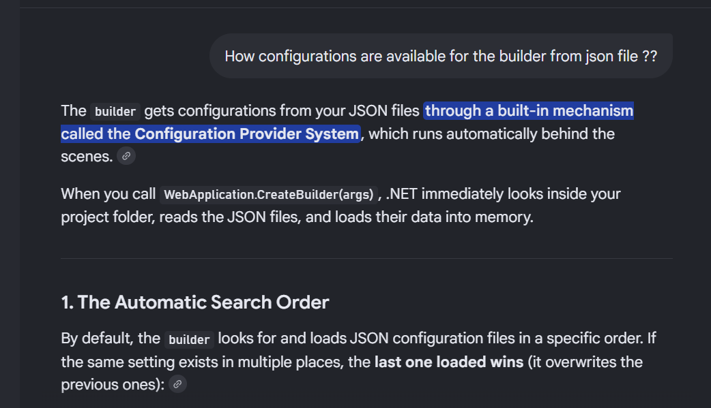
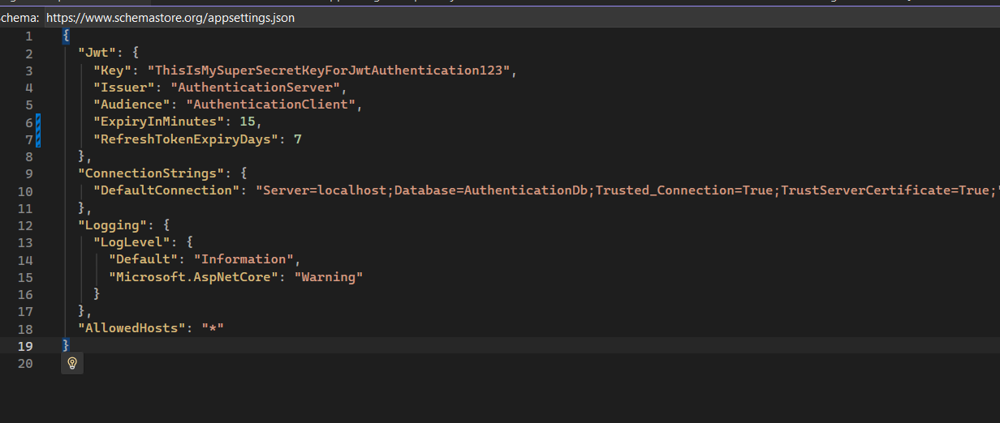

. GetSection("Jwt")What it does: It searches the configuration data for a specific branch or "block" and isolates it.What it returns: An IConfigurationSection object.The Concept: Think of your appsettings.json file as a tree with branches. GetSection cuts off a specific branch (like the "Jwt" branch) and ignores everything else (like "Logging" or "ConnectionStrings"). It does not convert data types; it just isolates that specific chunk of text and keys.2. .Get<JwtSettings>()What it does: It performs Data Binding (deserialization). It takes the isolated text block from GetSection and automatically copies the values into a new instance of your C# class.What it returns: A strongly-typed C# object (in your case, an instance of JwtSettings).The Concept: It looks at the properties in your class (e.g., Issuer, Audience), finds matching keys in the JSON section, converts the text into the correct C# types (strings, integers, booleans), and populates the object.