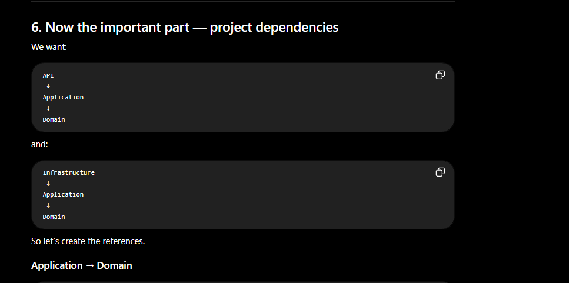
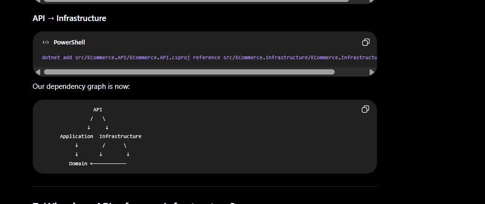

Microsoft Windows [Version 10.0.26200.9278]
(c) Microsoft Corporation. All rights reserved.

C:\Users\csban\OneDrive\Desktop\LearningC#>mkdir ECommerce

C:\Users\csban\OneDrive\Desktop\LearningC#>cd ECommerce

C:\Users\csban\OneDrive\Desktop\LearningC#\ECommerce>dotnet new sln -n ECommerce
The template "Solution File" was created successfully.

C:\Users\csban\OneDrive\Desktop\LearningC#\ECommerce>mkdir src

C:\Users\csban\OneDrive\Desktop\LearningC#\ECommerce>mkdir tests

C:\Users\csban\OneDrive\Desktop\LearningC#\ECommerce>dotnet new webapi -n ECommerce.API -o src/ECommerce.API
The template "ASP.NET Core Web API" was created successfully.

Processing post-creation actions...
Restoring C:\Users\csban\OneDrive\Desktop\LearningC#\ECommerce\src\ECommerce.API\ECommerce.API.csproj:
Restore succeeded with 1 warning(s) in 3.5s
    C:\Users\csban\OneDrive\Desktop\LearningC#\ECommerce\src\ECommerce.API\ECommerce.API.csproj : warning NU1903: Package 'Microsoft.OpenApi' 2.0.0 has a known high severity vulnerability, https://github.com/advisories/GHSA-v5pm-xwqc-g5wc
Restore succeeded.

C:\Users\csban\OneDrive\Desktop\LearningC#\ECommerce>dotnet new classlib -n ECommerce.Application -o src/ECommerce.Application
The template "Class Library" was created successfully.

Processing post-creation actions...
Restoring C:\Users\csban\OneDrive\Desktop\LearningC#\ECommerce\src\ECommerce.Application\ECommerce.Application.csproj:
Restore succeeded.

C:\Users\csban\OneDrive\Desktop\LearningC#\ECommerce>dotnet new classlib -n ECommerce.Domain -o src/ECommerce.Domain
The template "Class Library" was created successfully.

Processing post-creation actions...
Restoring C:\Users\csban\OneDrive\Desktop\LearningC#\ECommerce\src\ECommerce.Domain\ECommerce.Domain.csproj:
Restore succeeded.

C:\Users\csban\OneDrive\Desktop\LearningC#\ECommerce>dotnet new classlib -n ECommerce.Infrastructure -o src/ECommerce.Infrastructure
The template "Class Library" was created successfully.

Processing post-creation actions...
Restoring C:\Users\csban\OneDrive\Desktop\LearningC#\ECommerce\src\ECommerce.Infrastructure\ECommerce.Infrastructure.csproj:
Restore succeeded.

C:\Users\csban\OneDrive\Desktop\LearningC#\ECommerce>dotnet sln add src/ECommerce.API/ECommerce.API.csproj
Project `src\ECommerce.API\ECommerce.API.csproj` added to the solution.

C:\Users\csban\OneDrive\Desktop\LearningC#\ECommerce>dotnet sln add src/ECommerce.Application/ECommerce.Application.csproj
Project `src\ECommerce.Application\ECommerce.Application.csproj` added to the solution.

C:\Users\csban\OneDrive\Desktop\LearningC#\ECommerce>dotnet sln add src/ECommerce.Domain/ECommerce.Domain.csproj
Project `src\ECommerce.Domain\ECommerce.Domain.csproj` added to the solution.

C:\Users\csban\OneDrive\Desktop\LearningC#\ECommerce>dotnet sln add src/ECommerce.Infrastructure/ECommerce.Infrastructure.csproj
Project `src\ECommerce.Infrastructure\ECommerce.Infrastructure.csproj` added to the solution.

C:\Users\csban\OneDrive\Desktop\LearningC#\ECommerce>dotnet sln list
Project(s)
----------
src\ECommerce.API\ECommerce.API.csproj
src\ECommerce.Application\ECommerce.Application.csproj
src\ECommerce.Domain\ECommerce.Domain.csproj
src\ECommerce.Infrastructure\ECommerce.Infrastructure.csproj

C:\Users\csban\OneDrive\Desktop\LearningC#\ECommerce>dotnet add src/ECommerce.Application/ECommerce.Application.csproj reference src/ECommerce.Domain/ECommerce.Domain.csproj
Reference `..\ECommerce.Domain\ECommerce.Domain.csproj` added to the project.

C:\Users\csban\OneDrive\Desktop\LearningC#\ECommerce>dotnet add src/ECommerce.Infrastructure/ECommerce.Infrastructure.csproj reference src/ECommerce.Application/ECommerce.Application.csproj
Reference `..\ECommerce.Application\ECommerce.Application.csproj` added to the project.

C:\Users\csban\OneDrive\Desktop\LearningC#\ECommerce>dotnet add src/ECommerce.Infrastructure/ECommerce.Infrastructure.csproj reference src/ECommerce.Domain/ECommerce.Domain.csproj
Reference `..\ECommerce.Domain\ECommerce.Domain.csproj` added to the project.

C:\Users\csban\OneDrive\Desktop\LearningC#\ECommerce>dotnet add src/ECommerce.API/ECommerce.API.csproj reference src/ECommerce.Application/ECommerce.Application.csproj
Reference `..\ECommerce.Application\ECommerce.Application.csproj` added to the project.

C:\Users\csban\OneDrive\Desktop\LearningC#\ECommerce>dotnet add src/ECommerce.API/ECommerce.API.csproj reference src/ECommerce.Infrastructure/ECommerce.Infrastructure.csproj
Reference `..\ECommerce.Infrastructure\ECommerce.Infrastructure.csproj` added to the project.

C:\Users\csban\OneDrive\Desktop\LearningC#\ECommerce>^A

dotnet add src/ECommerce.Infrastructure package Microsoft.EntityFrameworkCore
dotnet add src/ECommerce.Infrastructure package Microsoft.EntityFrameworkCore.SqlServer
dotnet add src/ECommerce.Infrastructure package Microsoft.EntityFrameworkCore.Design
dotnet add src/ECommerce.Infrastructure package Microsoft.EntityFrameworkCore.Tools